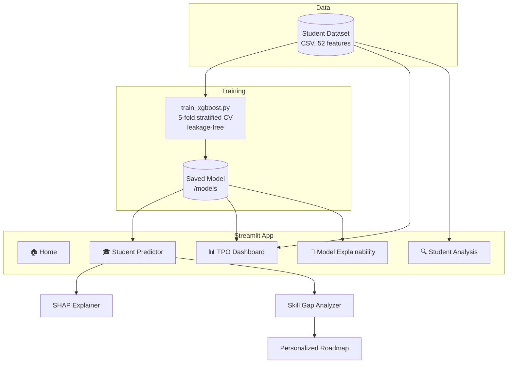

# 🎓 AI Placement Predictor
### *Decode Employability DNA: Institutional Career Readiness & Upskilling Engine*

> Not just "will this student get placed?" but **why**, **what's missing**, and **what to do next**.

🏅 **4th Prize: Spectrum National-Level Hackathon**

---

## 🎯 Problem Statement

**Domain:** Data Science / Artificial Intelligence · **Time limit:** 16 hours · **Team size:** up to 4

Placement readiness depends on far more than grades. Technical certifications, projects, internships, aptitude and communication all matter. Yet college placement offices rarely have a data-driven way to tell **who is genuinely placement-ready** and **who needs targeted upskilling**.

The challenge was to build an **internal institutional intelligence platform** for **students** and **Training & Placement Officers (TPOs)** that:

- models a student's employability profile and calculates a **transparent placement probability**
- diagnoses **specific skill gaps**
- auto-generates a **personalized career roadmap**
- gives TPOs **department-wide cohort analytics**

It is an **explainable predictive modeling and gap-analysis system**, not a job board or recruitment ATS. It runs entirely inside the college ecosystem.

### Input dimensions modeled

| Dimension | Examples |
|---|---|
| 📚 Academic track record | CGPA, 10th/12th percentages, backlog history |
| 💻 Technical competencies | Programming languages, frameworks, certifications |
| 🛠️ Practical experience | Project complexity, open-source work, internships |
| 🧠 Aptitude & problem solving | Quantitative, logical and coding benchmarks |
| 🗣️ Soft skills & communication | Verbal fluency, interview ratings, presentation scores |
| 🏆 Extracurriculars | Hackathons, leadership roles, tech societies |

---

## 💡 Solution

**AI Placement Predictor** is a full-stack analytics and ML web platform built on a **leakage-free XGBoost classifier** that evaluates a student's complete profile across **52 features**. It delivers:

- 📈 **placement probability** (0–100%) and a **readiness status**: *Ready*, *Near Ready* or *Needs Training*
- 🔍 **SHAP explanations** showing which factors boosted or penalized the score
- 🧩 **skill-gap analysis** against target career roles
- 🗺️ a **personalized, phased roadmap** with courses, project topics and time-to-completion
- 📊 a **TPO dashboard** with branch-wise readiness, at-risk student filters and skill-deficit heatmaps

---

## ✅ Hackathon Requirements Covered

| Mandatory module | Status |
|---|---|
| Student profile & data ingestion | ✅ |
| ML-driven placement probability & readiness status | ✅ |
| Target role mapping | ✅ |
| Explainable AI (SHAP) factor transparency | ✅ |
| Skill-gap diagnostic | ✅ |
| Personalized phased roadmap | ✅ |
| TPO institutional dashboard (readiness metrics, vulnerability filters, skill heatmaps) | ✅ |

---

## ✨ Features

### 🎓 For Students
- **Student Predictor:** enter a full profile and get probability, readiness status and target-role alignment
- **SHAP explainability:** see exactly which parameters helped or hurt the score
- **Role-specific skill-gap analysis:** benchmark against target career profiles
- **Personalized career roadmap:** 4 phases with timeline and recommended courses

### 📊 For TPOs / Institutions
- **Batch analytics** across the whole cohort (1,000 students in the dataset)
- **Departmental readiness metrics:** overall and branch-wise
- **Readiness distribution:** Ready / Near Ready / Needs Training counts
- **Vulnerable-student identification:** instantly filter students below the readiness threshold
- **Institutional skill heatmap:** department-wise gaps in programming, aptitude and communication
- **Multi-criterion filters:** Department, Semester, Target Role and Placement Outcome
- **Student Analysis:** search and inspect any individual profile

### 🤖 Model Transparency
- **5-fold stratified cross-validation** metrics
- **Feature importance** views
- **Leakage-free** training pipeline

### 🛡️ The 6 Employability Pillars
| Pillar | What's measured |
|---|---|
| 💻 Programming | Python, Java, SQL, React, AWS, DSA |
| 🎙️ Interview | Technical and behavioral interview scores |
| 🧠 Aptitude | Quantitative and logical reasoning |
| 🗣️ Communication | Verbal fluency and presentation |
| 🛠️ Projects | Project count and complexity |
| 🏆 Hackathons | Number of hackathons participated in |

---

## 🛠️ Tech Stack

| Layer | Technology |
|---|---|
| Language | Python |
| Frontend / UI | Streamlit (multi-page app, custom dark glassmorphism CSS) |
| ML Model | XGBoost Classifier |
| Explainability | SHAP (Tree Explainer) |
| Data | Synthetic/anonymized student dataset (`AI_Placement_Predictor_Dataset_V3.csv`) |
| Dev / CI | GitHub Actions, Dev Container |

---

## 🏗️ System Architecture



### Project Structure

```
AI-PLACEMENT-PREDICTOR/
├── app.py                                  # Streamlit entry point (Home page)
├── pages/                                  # Student Predictor, TPO Dashboard, Student Analysis, Model Explainability
├── models/                                 # Trained XGBoost model artifacts
├── utils/                                  # Helper modules
├── reports/                                # Generated reports / metrics
├── train_xgboost.py                        # Model training script
├── AI_Placement_Predictor_Dataset_V3.csv   # Student dataset
├── requirements.txt
├── .streamlit/                             # Streamlit config
├── .devcontainer/                          # Dev container setup
└── .github/workflows/                      # CI workflows
```

---

## ⚙️ How It Works

### 🎓 Student flow
1. **Profile input:** the student enters (or uploads) 52 features across academics, technical skills, aptitude, communication, experience and extracurriculars.
2. **XGBoost inference:** predicts the placement outcome, a probability score (0–100%) and a readiness status.
3. **SHAP explanation:** the Tree Explainer shows which factors contributed positively or negatively.
4. **Skill-gap analysis:** the profile is benchmarked against the target role's requirements.
5. **Roadmap generation:** a 4-phase action plan with a timeline and recommended courses.

### 📊 TPO flow
1. **Batch analytics** over the whole cohort.
2. **Readiness distribution** across Ready / Near Ready / Needs Training.
3. **Vulnerable-student filtering** to schedule targeted bootcamps.
4. **Skill heatmap** by department.
5. **Dynamic filters** by department, semester, role and outcome.

---


---

## 🔮 Future Scope

- 🔗 **Live integration** with college ERP / LMS data
- 🏢 **Company-specific prediction** using real job descriptions and hiring patterns
- 📄 **Resume parsing** to auto-fill the profile
- 📚 **Course integration:** link roadmap items to learning platforms and track progress
- 🔔 **Early-warning alerts** to students and TPOs
- 🧪 **Model upgrades:** compare LightGBM / CatBoost / ensembles with periodic retraining
- ⚖️ **Fairness auditing** across departments and demographics
- ☁️ **Cloud deployment** with authentication and role-based access (student / TPO / admin)
- 📱 **Mobile-friendly** UI

---

## 🏆 Hackathon Achievement

**🏅 4th Prize: Spectrum National-Level Hackathon**

Built within a **16-hour** window, and **all mandatory modules of the problem statement were implemented**: ingestion, ML probability engine, role mapping, SHAP explainability, skill-gap roadmap and the TPO dashboard.

---


⭐ If you find this useful, give it a star!
